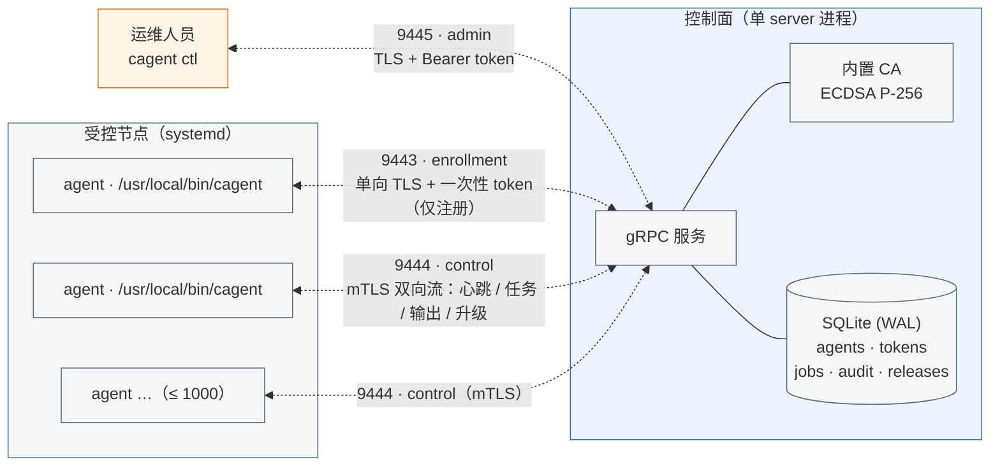
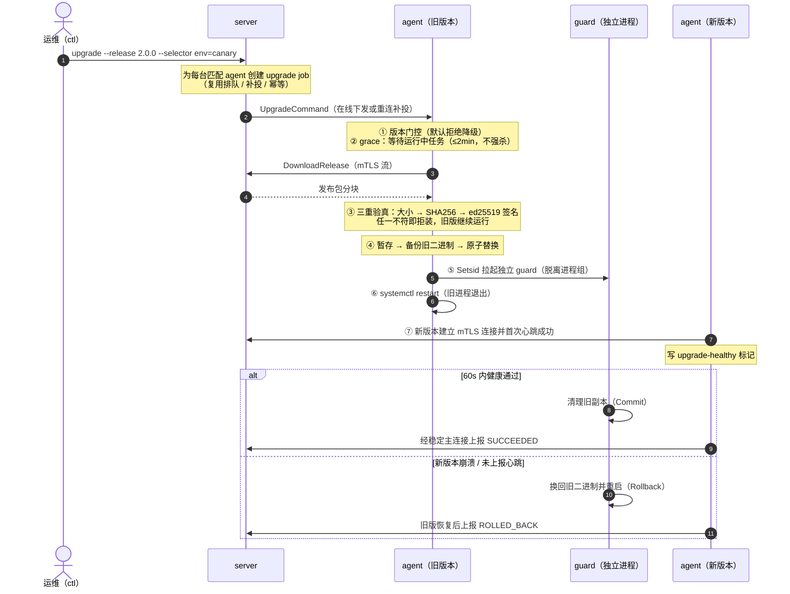

# cagent

多角色运维 Agent（multi-role operations agent）：装在 Linux 服务器上的单个静态二进制，
通过 **mTLS 双向认证** 向中心 Server 注册，接受远程任务执行，并支持**签名自升级与失败自动回滚**。

类似 Puppet Agent（配置管理）+ Zabbix Agent（监控采集）+ 运维控制通道的组合，
定位为多机运维体系中的受控节点核心。

- 单一二进制 `cagent`，子命令 `agent` / `server` / `ctl`
- 零外部服务依赖（内置 SQLite + CA），一个 server 进程即可支撑上千台 agent
- 所有远程操作经 mTLS 认证、标签选机、全程审计
- 升级包 ed25519 签名校验，新版本 60 秒健康门控失败自动换回旧版

---

## 架构



**三条独立链路（单一二进制 `cagent server` 暴露三个端口）**

| 端口 | 服务 | 认证 | 用途 |
|---|---|---|---|
| 9443 | EnrollmentService | 服务器 TLS + 一次性 enrollment token | 仅首次注册可达，签发 mTLS 身份证书 |
| 9444 | ControlService | **强制双向 mTLS**（吊销即时踢线） | 一条双向流承载心跳、任务下发/事件、输出、升级指令与包下载 |
| 9445 | ManagementService | 服务器 TLS + admin Bearer token | 仅 `cagent ctl` 使用，全部方法经拦截器鉴权 |

**可靠性设计**：agent 断线指数退避自动重连；离线任务重连后按序补投；排队任务 24h TTL 过期；
任务终态机 CAS 防回退；同 `job_id` 重发幂等不重复执行；升级结果由重启后稳定主连接上报，
避免短连接与重连竞争。

## 能力清单

| 能力 | 说明 |
|---|---|
| 注册接入 | 一次性 enrollment token（可复用、TTL、吊销）、UUID 身份、证书自动续签 |
| 心跳与在线状态 | 15s 心跳、45s 判离线、标签/版本全集上报 |
| 远程执行 | `/bin/sh -c`、工作目录/环境变量、默认 5 分钟（硬上限 60 分钟）、超时/取消以 **SIGKILL 杀整个进程组** |
| 输出回收 | stdout/stderr 分流，单任务输出上限 1MB（超限截断标记） |
| 幂等与补投 | at-least-once 投递 + 终态结果缓存，重发同一 job 不重复执行 |
| 审计 | server 端 audit_logs（操作者/命令/退出码/标签）+ agent 本地 JSONL 留痕 |
| 标签灰度 | 任务/升级均按标签 AND 选机，如 `env=prod,role=db` |
| 签名自升级 | tar.gz 包 + manifest，**大小→SHA256→ed25519 三重验真** |
| 健康门控回滚 | 替换→重启→新版本 60s 内 mTLS 心跳成功才提交；失败独立 guard 自动换回旧版重启 |
| 防降级 | 语义版本比较，默认拒绝降级，仅显式 `--allow-downgrade` 放行 |
| 升级 grace | 升级到达时等待运行中任务最多 2 分钟，绝不杀用户任务 |
| 管理 CLI | token / agent / job / release / upgrade 全套命令 |

平台：systemd + glibc，linux/amd64、linux/arm64，CGO 纯静态（sqlite 为纯 Go 驱动）。

---

## 快速开始

### 1. 构建

```bash
make build            # 本机二进制 dist/cagent
make build-linux      # linux/amd64 + linux/arm64 静态二进制
make test-race        # 全量单测（-race）
make package VERSION=1.2.3   # 生成可签名的升级包
```

需要 Go 1.27+。重新生成 gRPC 代码需 `protoc` + `protoc-gen-go(-grpc)`（见 `proto/README.md`，
生成的 `*.pb.go` 已入库，普通构建不依赖 protoc）。

### 2. 启动 server

```bash
sudo cagent server --config /etc/cagent/server.yaml
```

```yaml
# /etc/cagent/server.yaml
enrollment_listen: ":9443"
control_listen:    ":9444"
admin_listen:      ":9445"
data_dir: "/var/lib/cagent-server"
server_cert_hosts: ["server.example.com", "10.0.0.1"]
```

首启自动生成：内置 CA 与服务器证书（`data_dir/ca/`）、SQLite 库、
**admin token**（`data_dir/admin_token`，0600，仅此时可读）。

### 3. 配置 ctl 并创建安装令牌

```bash
mkdir -p ~/.config/cagent
cat > ~/.config/cagent/ctl.yaml <<EOF
admin_address: "server.example.com:9445"
admin_token:   "$(sudo cat /var/lib/cagent-server/admin_token)"
server_ca_file: "/etc/cagent/ca.crt"
EOF

cagent ctl token create --ttl 24 --description "batch-db"
# token（明文仅此一次显示）:
# cagt_xxxxxxxxxxxxxxxxxxxxxxxxxxxxxxxx
# id=et_xxx 过期=...
```

也可用环境变量 `CAGENT_ADMIN_ADDR` / `CAGENT_ADMIN_TOKEN`。

### 4. 安装 agent

把 `cagent`（对应架构）、`deploy/cagent.service`、server CA 与安装脚本放到目标机：

```bash
sudo ./scripts/install.sh \
  --enrollment-addr server.example.com:9443 \
  --control-addr    server.example.com:9444 \
  --token           cagt_xxxx \
  --server-ca       ca.crt \
  --signing-pubkey  release.pub \
  --label env=prod --label role=db
```

安装脚本完成：平台检测（root/systemd/glibc/架构）→ 二进制落 `/usr/local/bin/cagent`
→ 写 0600 配置 → 装 systemd 单元 → `enable + start`，失败自动回滚不留半安装。

或手写配置：

```yaml
# /etc/cagent/config.yaml
enrollment_address: "server.example.com:9443"
control_address:    "server.example.com:9444"
enrollment_token:   "cagt_xxxx"
server_ca_file:     "/etc/cagent/ca.crt"   # 或 server_ca_fingerprint
data_dir: "/var/lib/cagent"
labels:
  env: prod
  role: db
```

### 5. 使用

```bash
# 查看机器
cagent ctl agent list
cagent ctl agent show <uuid>

# 按标签下发任务（AND）并跟踪
cagent ctl job run --selector env=prod --selector role=db --timeout 60 'uptime'
cagent ctl job show <job-id>
cagent ctl job list --status running
cagent ctl job cancel <job-id>

# 发布与升级
cagent ctl release keygen --key release.key --pub release.pub  # 首次：离线生成 ed25519 密钥对
cagent ctl release package --binary dist/cagent-linux-amd64 --version 1.2.3 \
  --out cagent-1.2.3.pkg
cagent ctl release sign --key release.key --pkg cagent-1.2.3.pkg
cagent ctl release publish --pkg cagent-1.2.3.pkg --sig cagent-1.2.3.pkg.sig
cagent ctl release list

cagent ctl upgrade --release 1.2.3 --selector env=canary
cagent ctl upgrade --release 1.2.3 --selector env=prod --allow-downgrade
```

token 管理：`cagent ctl token list | revoke <id>`。

---

## 自升级与回滚机制



设计要点：

- **guard 与 systemd cgroup 解耦**：生产环境用 `systemd-run` 把 guard 放进独立的
  transient unit（`cagent-upgrade-*.service`，`--collect` 退出即回收）。仅 `Setsid`
  脱离进程组仍处于 `cagent.service` 的 cgroup 中，会在 `systemctl restart` 时被
  `KillMode=control-group` 一起杀掉；独立 unit 才能在服务重启期间存活
- **restart 也脱离 cgroup**：agent 不能同步执行 `systemctl restart cagent.service`
  （会把发起命令的自己一并 SIGTERM），重启动作同样经 `systemd-run` 的独立 oneshot
  unit 延迟执行；非 systemd 环境回退为 `Setsid` 脱离进程（测试用注入命令）
- **guard 运行可信旧二进制**：guard 由升级前备份的 `cagent.old` 启动，而非刚
  替换的新版本。否则一旦新版本损坏（崩溃/无心跳/行为异常），guard 自己也是坏的，
  将永远无法回滚——这是自升级最关键的不变量
- **健康判据是真实通信**：新版本必须在 60s 内通过 mTLS 心跳（而非仅进程存活）；
  有缺陷的新版本（进程活着但无法建连）同样会被判定不健康并自动回滚
- **早期失败清理现场**：版本门控/grace/验签/替换失败（不触发重启）时由主进程
  清理 `upgrade-state.json`，避免残留干扰后续升级；guard 路径则在退出时清理
- **结果走主连接**：guard 只写 `upgrade-result.json`，由重启后接管的 agent 经
  自己的稳定主连接上报，避免 guard 短连接与 agent 重连竞争控制流
- **升级单飞**：同一 agent 同一时刻只允许一个升级流程，防止在线下发与补投并发

---

## 目录结构（agent 侧）

```
/usr/local/bin/cagent              二进制（0755）
/etc/cagent/config.yaml            配置（0600）
/etc/cagent/ca.crt                 server CA 锚点
/var/lib/cagent/                   状态根（0700）
├── identity / agent.key / agent.crt / ca.crt
├── audit.log                      本地执行审计 JSONL
├── upgrade-healthy                新版本健康标记
├── upgrade-result.json            guard → agent 的待上报结果
└── releases/                      cagent.staged / cagent.old
```

server 侧数据在 `/var/lib/cagent-server/`（SQLite、CA、发布包 `releases/`）。

配置示例见 [`deploy/examples/`](deploy/examples)（agent/server/ctl）。

## 运维与数据保留

- 服务日志走 journald（`journalctl -u cagent`），由 systemd 自动轮转
- agent 本地执行审计 `audit.log` 为追加 JSONL，`install.sh` 会安装
  `logrotate` 规则（`deploy/cagent-agent.logrotate`，每日轮转保留 14 份）；
  手工安装时可自行放到 `/etc/logrotate.d/`
- server 端终态 job（含输出）与审计按保留期自动清理（`job_retention` 默认 30 天、
  `audit_retention` 默认 90 天，每小时一次；负值禁用）；在途 pending/running 任务永不清理
- 三个端口均暴露标准 `grpc.health.v1` 健康检查，可用于存活探针/负载均衡
- server 数据（SQLite + 发布包）位于 `/var/lib/cagent-server/`：
  - `cagent-server.db` 保存 agent、token、job（含输出，单任务上限 1MB）、审计
  - 终态 job/输出/审计由内置 janitor 按保留期自动清理（见上）；如需更长保留期调整配置即可
- 备份：停服后复制整个数据目录即可（含 CA 密钥与 SQLite），恢复时保持 0600/0700 权限

## 只读状态面板

server 可选启用一个**只读** HTTP 状态面板，零外部依赖（Go `net/http` + `html/template`）：

```yaml
# server.yaml
dashboard_listen: "127.0.0.1:9446"   # 建议仅绑本地或经反代加 TLS
dashboard_token: "面板访问令牌"        # 启用时必填
```

访问方式：

```bash
# Bearer 头（适合脚本/反代）
curl -H "Authorization: Bearer <token>" http://127.0.0.1:9446/
# 浏览器首次访问（token 在 URL，不会出现在页面链接中）
open "http://127.0.0.1:9446/?token=<token>"
# 存活探针，无需令牌
curl http://127.0.0.1:9446/healthz
```

面板展示：Agent 在线/版本/标签/心跳/证书到期、最近任务状态、发布版本、最近审计。

**安全边界**：

- 只有 GET、**无任何写操作入口**（命令/升级/token 管理仍走 mTLS gRPC 与 ctl）
- Bearer 令牌常量时间比较；缺令牌一律 401；POST 等非 GET 方法返回 405
- 输出经 `html/template` 自动转义（防 XSS），带 `X-Frame-Options: DENY`、CSP 等安全头
- 不应直接暴露公网；需要远程访问时用 SSH 隧道或带 TLS/鉴权的反向代理

## 发布流程

版本号用语义化 `x.y.z`。二进制由 CI 从 git tag 构建并注入版本信息
（`-ldflags -X internal/version.Version=…`），默认本地构建为 `dev`。

### 方式一：打 tag 自动发布（推荐）

推送 `v*` tag 即触发 GitHub Actions（`.github/workflows/release.yml`）：
跑测试 → 构建 linux/amd64 + linux/arm64 静态二进制 → 计算 SHA256 → 创建 GitHub Release。

```bash
git tag -a v1.2.3 -m "v1.2.3"
git push origin v1.2.3
# Release 产物：cagent-1.2.3-linux-amd64 / -linux-arm64 / -SHA256SUMS
```

日常 push/PR 由 `.github/workflows/ci.yml` 跑 gofmt、vet、`-race` 测试与交叉编译。

### 方式二：本地构建

```bash
make release-assets VERSION=1.2.3
# dist/cagent-1.2.3-linux-amd64
# dist/cagent-1.2.3-linux-arm64
# dist/cagent-1.2.3-SHA256SUMS
```

### 制作并发布签名升级包

ed25519 签名私钥**离线妥善保管，不进 CI**：

```bash
# 首次：生成签名密钥对（公钥通过 install.sh --signing-pubkey 分发给 agent）
cagent ctl release keygen --key release.key --pub release.pub

# 用已发布的 linux 二进制打 tar.gz 包并离线签名
cagent ctl release package --binary cagent-1.2.3-linux-amd64 \
  --version 1.2.3 --out cagent-1.2.3.pkg
cagent ctl release sign --key release.key --pkg cagent-1.2.3.pkg
# 产物：cagent-1.2.3.pkg + cagent-1.2.3.pkg.sig

# 上传到运行中的 server（经 admin API）
cagent ctl release publish --pkg cagent-1.2.3.pkg --sig cagent-1.2.3.pkg.sig

# 灰度/全量
cagent ctl upgrade --release 1.2.3 --selector env=canary
```

校验发布产物完整性：
```bash
sha256sum -c cagent-1.2.3-SHA256SUMS
```

## 测试

```bash
make test-race      # 单元测试（选择器/状态机/执行器进程组/幂等/版本/CA/guard 决策…）
go test ./test/e2e  # 端到端：本机起真 server+agent 双进程，覆盖
                    #   mTLS 注册上线 / run 输出退出码 / cancel /
                    #   离线扫描+补投 / 自升级全链路 / 降级拒绝

test/e2e/docker_systemd_test.sh    # Ubuntu 容器内验证安装布局与 Restart=always
```

e2e 用临时数据目录与 loopback 端口，无需外部依赖；自升级用例通过注入
`restart_command` 模拟 systemctl（生产为 `systemctl restart cagent.service`）。

## 仓库布局

```
cmd/cagent              入口（agent/server/ctl/--guard-mode）
internal/
  agent/                identity trust register control executor
                        jobworker audit upgrade（下载/验签/guard/状态机）
  server/               ca enrollservice controlservice dispatch
                        management enrollment admin store(SQLite)
  ctl/                  管理 CLI
  config/ logging/ paths/ version/
  release/              打包/manifest/ed25519 签名/语义版本
proto/cagent/v1/        gRPC 契约（enrollment/control/management）
deploy/                 systemd 单元
scripts/install.sh      一键安装
test/e2e/               双进程端到端测试
openspec/               需求、规格与变更记录（规格驱动开发）
```

## 安全边界

- 强制 mTLS（注册端口也要求服务器证书），**没有也不会提供 `--insecure`**
- 信任锚点只来自安装参数（CA PEM 或 SHA256 指纹）
- 升级包必须通过 ed25519 签名校验，公钥随 agent 安装分发
- admin/enrollment token 文件 0600；agent 以 root 运行（远程运维需要），
  systemd 单元开启 `NoNewPrivileges`/`ProtectSystem`/`PrivateTmp`
- 每条远程命令双端审计；取消/超时按进程组 SIGKILL，不留孤儿

## License

见仓库 LICENSE。
